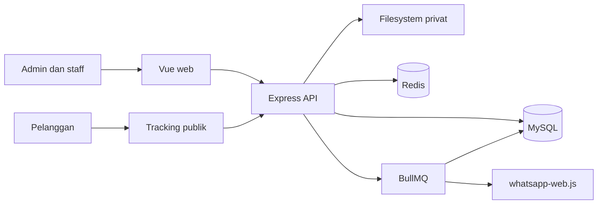

# Arsitektur — Cicuci Sepatu

## Keputusan MVP

- Monorepo: `apps/web`, `apps/api`.
- Web: Vue 3, Vite, TypeScript strict, Tailwind CSS.
- API: Node.js, Express, TypeScript strict, Zod.
- Data utama: MySQL 8 dengan Prisma. Keputusan ini menggantikan PostgreSQL pada aturan awal.
- Background jobs: Redis dan BullMQ.
- Foto: filesystem privat pada host. MySQL hanya menyimpan metadata serta `storageKey`.
- Satu outlet. Tidak ada booking, kurir, payment gateway, aplikasi native, atau multi-tenant pada MVP.

## Batas aplikasi



## Struktur target

```text
apps/
  api/
    src/
      controllers/
      services/
      repositories/
      integrations/
        storage/
        whatsapp/
      jobs/
      middleware/
      validators/
      lib/
    prisma/
      schema.prisma
      migrations/
  web/
    src/
      pages/
      components/
      features/
      services/
      router/
      stores/
packages/
  shared/
    src/
      contracts/
      constants/
```

`packages/shared` hanya menyimpan kontrak DTO dan konstanta status. Tidak menyimpan Prisma, Express, Vue, secret, atau logika bisnis.

## API modular

| Lapisan | Tanggung jawab |
|---|---|
| Controller | HTTP, autentikasi request, parse Zod, response. Tidak mengirim WhatsApp. |
| Service | Transaction, otorisasi bisnis, status transition, total, outbox. |
| Repository | Query Prisma. Tidak memutuskan aturan bisnis. |
| Integration | Adapter filesystem, WhatsApp Web; fake hanya pada test. Interface minimal. |
| Job | Claim event outbox, deduplikasi, retry, catat attempt. |

Operasi yang mengubah status item menjalankan satu transaksi MySQL: validasi state, tulis `StatusHistory`, ubah item, turunkan status order, buat `NotificationEvent` bila perlu. Worker terpisah memproses event setelah commit. Kegagalan WhatsApp tidak membatalkan operasi laundry.

## Keamanan

- Admin memakai session HTTP-only, `Secure` pada production, `SameSite=Lax`; password Argon2id.
- RBAC owner/admin/staff di middleware dan service.
- Tracking token: 32 byte acak, simpan hash SHA-256; token mentah hanya dikembalikan ketika dibuat/dirotasi.
- Approval token: satu kali pakai, kedaluwarsa; hash disimpan. Approval risiko bukan persetujuan WhatsApp.
- File berada di luar static public directory. Unduh melalui endpoint berotorisasi atau validasi tracking token serta relasi order.
- Allowlist MIME, validasi signature file, batas ukuran dan jumlah foto. Nama file dibuat server.
- Rate limit login, tracking, consent, upload. Semua input Zod. Audit action sensitif.

## Konfigurasi

Gunakan environment variables: `DATABASE_URL`, `REDIS_URL`, `SESSION_SECRET`, `TOKEN_PEPPER`, `UPLOAD_ROOT`, `MAX_UPLOAD_BYTES`, `APP_BASE_URL`. Tidak ada credential di repository.

## Batas pengiriman

- Docker Compose menjalankan MySQL, Redis, API, web; volume terpisah untuk MySQL dan upload privat.
- Backup MySQL dan upload harus atomik secara operasional: snapshot database serta salinan direktori upload pada jadwal sama.
- Production storage provider dapat ditambah sebagai adapter `StorageProvider`; tidak dibangun sebelum target deployment memerlukannya.
