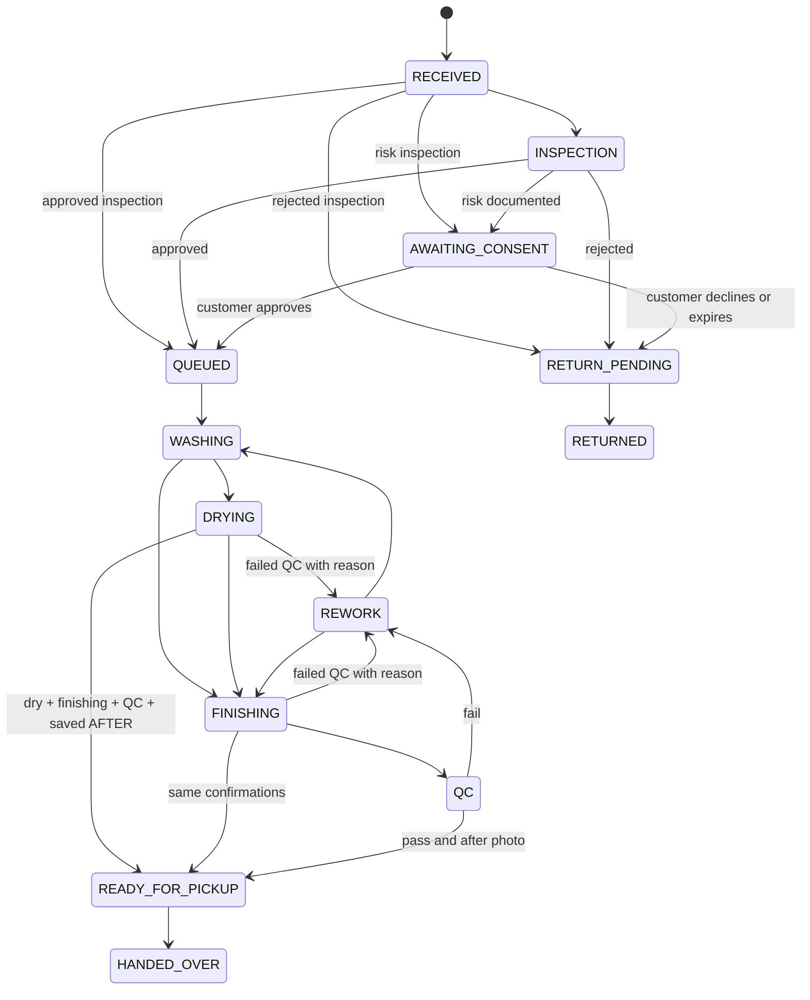
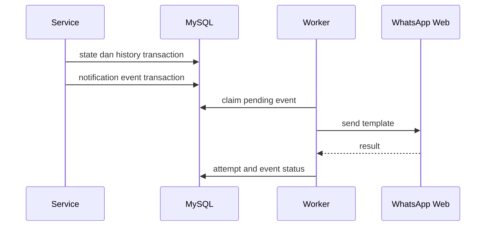

# Business Flow — Cicuci Sepatu

## State item

Status enum: `RECEIVED`, `INSPECTION`, `AWAITING_CONSENT`, `QUEUED`, `WASHING`, `DRYING`, `FINISHING`, `QC`, `REWORK`, `READY_FOR_PICKUP`, `HANDED_OVER`, `RETURN_PENDING`, `RETURNED`.

Inspection outcome bukan status: `APPROVED`, `NEEDS_CONSENT`, `REJECTED`, `DECLINED`.

## Transition table

| Dari | Tujuan yang diizinkan | Guard server |
|---|---|---|
| RECEIVED | INSPECTION; inspection finalization to QUEUED/AWAITING_CONSENT/RETURN_PENDING | same inspection guards as INSPECTION; no synthetic intermediate history |
| INSPECTION | QUEUED | inspection APPROVED; harga final non-negatif |
| INSPECTION | AWAITING_CONSENT | outcome NEEDS_CONSENT; Temuan/Risiko bermakna, BEFORE, harga tersedia; foto risiko privat opsional; buat approval request |
| INSPECTION | RETURN_PENDING | outcome REJECTED; set final price nol |
| AWAITING_CONSENT | QUEUED | customer APPROVE; decision/timestamp tersimpan |
| AWAITING_CONSENT | RETURN_PENDING | customer DECLINE atau request expired; set final price nol |
| QUEUED | WASHING | outcome APPROVED atau consent APPROVE |
| WASHING | DRYING, FINISHING | — |
| DRYING | READY_FOR_PICKUP, REWORK (failed QC + reason), FINISHING (legacy) | ready: explicit dry + finishing complete + QC pass; saved visible AFTER; approved/consented |
| FINISHING | READY_FOR_PICKUP, REWORK (failed QC + reason), QC (legacy) | same ready guards |
| QC | READY_FOR_PICKUP | explicit dry + finishing complete + QC pass; minimal satu photo AFTER customer-visible; approved/consented |
| QC | REWORK | QC fail; reason wajib |
| REWORK | WASHING, FINISHING | reason/rework history ada |
| READY_FOR_PICKUP | HANDED_OVER | admin; payment dapat tetap UNPAID |
| RETURN_PENDING | RETURNED | admin; final price nol |

Selain tabel: `409 INVALID_TRANSITION`. Tidak ada override manual MVP. Semua transition mencatat `StatusHistory` dengan old/new, actor, waktu, alasan.

## Inspection dan risk consent

1. Admin/staff mengisi outcome, Temuan/Risiko wajib untuk NEEDS_CONSENT, BEFORE wajib, harga final; catatan internal privat dan foto damage/risk privat opsional.
2. `APPROVED`: item dapat `QUEUED`.
3. `NEEDS_CONSENT`: buat `ConsentDecision` dengan snapshot risiko/harga, token acak hash, expiry. Event WhatsApp consent dibuat bila opt-in.
4. Pelanggan membuka tracking lalu kirim token approval dan `APPROVE` atau `DECLINE`.
5. Consume token satu kali dalam transaction. Approve menuju `QUEUED`; decline menuju `RETURN_PENDING` dan harga nol.
6. Token kadaluarsa tidak otomatis berarti penolakan tanpa kebijakan owner. Cron menandai expired; admin menerbitkan ulang atau memproses return dengan reason terdokumentasi.

## Estimasi otomatis pesanan baru

Server memakai waktu pembuatan yang disimpan, zona Asia/Jakarta. Lima hari kalender inklusif; akhir pekan dihitung. Sebelum 12.00 WIB: tanggal tersebut hari ke-1; mulai 12.00 WIB: besok hari ke-1. Selasa 11.59 selesai Sabtu; Selasa 12.00 selesai Minggu. Simpan akhir tanggal estimasi pukul 23:59:59.999 WIB (16:59:59.999 UTC), bukan tengah malam. Form pembuatan tidak meminta tanggal. Tanggal legacy dari klien diabaikan; replay idempoten mempertahankan estimasi awal. Estimasi historis serta edit estimasi tetap tersedia.

## Aggregate order

Order menyimpan `aggregateStatus` cache. Service menghitung ulang setiap item transition, add/remove item, consent, atau return.

Prioritas tampilan:

1. Semua item terminal `HANDED_OVER` atau `RETURNED`: `COMPLETED`.
2. Ada item `READY_FOR_PICKUP`: `READY_FOR_PICKUP`.
3. Ada item `WASHING`, `DRYING`, `FINISHING`, `QC`, `REWORK`: `IN_PROGRESS`.
4. Ada item `AWAITING_CONSENT`: `AWAITING_CONSENT`.
5. Ada item `INSPECTION`: `WAITING_INSPECTION`.
6. Lainnya: `RECEIVED` atau `QUEUED` sesuai status item paling awal.

Aggregate hanya untuk filter/dashboard. Detail tracking selalu menampilkan status per item.

## Price dan payment

- `totalAcceptedIdr = sum(finalPriceIdr)` untuk item bukan REJECTED/DECLINED.
- Transition to RETURN_PENDING dari reject/decline selalu mengeset final price nol.
- Payment status: `UNPAID` bila paid nol; `PARTIAL` bila lebih dari nol dan kurang dari total; `PAID` bila sama total; `REFUNDED` bila total payment valid kembali nol setelah refund flow tersedia.
- Status payment tidak memblokir washing, ready pickup, atau handover MVP.

## Notification outbox

Event type: `ORDER_RECEIVED`, `INSPECTION_RESULT`, `CONSENT_REQUEST`, `WASHING_STARTED`, `FINISHING_STARTED`, `READY_FOR_PICKUP`, `HANDED_OVER`, `PICKUP_REMINDER`.

- `eventKey` deterministik: order/item/event/status-history ID. Unique constraint mencegah duplikat.
- Worker memakai retry transient dengan exponential backoff serta attempt limit konfigurabel.
- Permanent failure dan opt-out ditandai, dicatat; tidak melempar ke transaction status.
- Tidak ada retry manual notifikasi. Tanpa aktivasi owner, event SKIPPED dengan alasan dan actualOutbound:false. Riwayat mock/SIMULATED tetap utuh; tidak dikonversi atau dikirim ulang.
- Notifikasi hanya saat consent WhatsApp aktif dan tidak opt-out. Risk decision tidak ekuivalen WhatsApp opt-in.

## Audit

Audit wajib untuk login failure/success, user/service config, order create/update, inspection, approval decision, status transition, photo deletion, token rotation, payment add/void, retry notification. Jangan simpan plaintext token/password atau data file binary.

## Peta halaman

| Area | Halaman | Role |
|---|---|---|
| Auth | login | publik |
| Dashboard | KPI, antrean, overdue | STAFF+ |
| Orders | list/filter/search, create | ADMIN+ untuk create |
| Order detail | item cards, history, foto, payment | STAFF+; mutation sesuai role |
| Inspection | inspection dan risk form | ADMIN+ |
| Work queue | assigned/current process, transition | STAFF+ |
| Customers | list/detail/create/edit | ADMIN+ |
| Services | price catalog | OWNER write |
| Notifications | queue, attempts, retry | ADMIN+ |
| Users/settings | users, store profile, template config | OWNER |
| Tracking | per-item progress, safe photos, total | token publik |
| Risk approval | risk snapshot, approve/decline | token publik + action token |

## Alur operator disederhanakan (disetujui owner 2026-11-11)
Pemeriksaan → Pengerjaan → Pengeringan → Siap diambil; Sudah diambil terminal. QUEUED menampilkan pemeriksaan disetujui dengan aksi Mulai pengerjaan. Risiko tertunda tetap memblokir pengerjaan. FINISHING/QC dilipat ke pengeringan; REWORK ke pengerjaan, aksi legacy tetap valid. Tidak mengubah history lama atau membuat transisi/notifikasi perantara palsu.

Pemeriksaan satu form: harga terisi, catatan, aman/perlu persetujuan/ditolak, foto BEFORE wajib otomatis, foto INSPECTION privat opsional untuk risiko. Siap diambil satu form: AFTER otomatis, konfirmasi eksplisit kering/finishing/QC. Foto wajib dan foto opsional yang dipilih disimpan sebelum finalisasi. API belum mendukung inspeksi terstruktur: peringatan aktivasi dekat tombol simpan, isian/file dipertahankan, tanpa unggah/perubahan inspeksi; error jaringan/otorisasi/server dijelaskan sebagai kegagalan pengecekan. Gagal: isian/status dipertahankan, tidak ada notifikasi ready. Retry memakai ulang foto berhasil dan idempotency key; tidak menggandakan unggahan/finalisasi. Detail lainnya mempertahankan edit, assignment, riwayat dan pengelolaan foto tanpa selector jenis. Harga belum final ditampilkan Harga belum dikonfirmasi. Pembayaran tetap terpisah.

## Smart package pricing — approved 2026-11-11 (historical v1; named-plan amendment below)

One OrderItem represents **one pair**, not a single shoe. New UI orders choose only Promo/Normal. Server resolves reserved internal cleaning service `cicuci-cleaning-v1` (`Cuci sepatu`, base price 0, active), idempotently inside the order transaction; never chooses/renames historical services. A conflicting reserved record fails closed. Menu Tarif pesanan displays readonly rates from authenticated GET /pricing/rates, calculated by packageTotal; legacy catalog management remains under Lanjutan: layanan lama with existing role permissions. Internal service edits are blocked; basePriceIdr is not the smart tariff. Existing manual orders (`pricing = NULL`) keep historical/manual behavior and editing.

| Pairs | Promo IDR | Normal IDR |
|---|---:|---:|
| 0 | 0 | 0 |
| 1 | 45,000 | 50,000 |
| 2 | 90,000 | 100,000 |
| 3 | 130,000 | 145,000 |
| 4 (3+1) | 175,000 | 195,000 |
| 5 | 210,000 | 225,000 |
| 6–9 | 41,000/pair | 45,000/pair |
| 10+ | 40,000/pair | 43,000/pair |

No artificial tier splitting. Integer rupiah allocation: sort item IDs, floor(total/count), distribute remainder one rupiah to earliest IDs. Snapshot v1 preserves rate mode, service, initial estimate, stage, allocations, agreement time and original agreed total/allocations.

Initial estimate counts all pairs. Rejected/risk-declined pairs always zero. Before all inspection/risk decisions finish, show ESTIMATE, not final charges. All decisions finished: FINAL, visible through admin/tracking before work. Explicit customer tracking confirmation, or admin confirmation with actual customer agreement evidence, locks the displayed total; stale totals rejected. Risk consent alone never locks prices. Work/payment blocked until LOCKED. Idempotent confirmation does not create another agreement. No mode/service/manual-price changes after lock. Later explicit cancellation with reason zeroes only that pair; remaining locked allocations never increase/repackage. Original agreement and audit metadata remain available. Payment/refund ledger immutable; excess is refundDueIdr/negative balance, never fabricated refund. Actual refunds use existing owner ledger action.

Smart receipt/status notifications append pricing stage and total through the existing outbox, not direct sends; previous encrypted snapshots/history remain immutable. Automatic five-calendar-day estimate and simplified inspection/ready workflow remain unchanged. Nullable additive migration only; old workers ignore the new column, no worker restart needed. Tests use isolated DB/provider fixtures and browser route mocks, never real customer mutations or WhatsApp sends.

API additions: POST /orders accepts optional rateMode (PROMO/NORMAL); smart items omit serviceId and quotedPriceIdr. Optional explicit packageServiceId/item serviceId must equal the reserved internal identity; unrelated historical services are rejected for new smart orders. Without rateMode, each manual item still requires serviceId. Legacy omission retains manual behavior. POST /orders/:id/pricing/confirm requires {totalIdr, confirmed:true, reason}; POST /track/:token/pricing/confirm requires {totalIdr, confirmed:true}. POST /items/:id/decline-cleaning requires {reason}; admin only, smart orders only, records return transition. Responses expose pricing snapshot and refundDueIdr. Smart inspection omits quotedPriceIdr; legacy inspection still requires it.

## Named rate plans — approved 2026-11-11 (supersedes fixed-only UI tariff selection)

Owners may create arbitrary named plans (for example Christmast), rename, replace all rules, deactivate/reactivate. Owner permanent deletion supported; see deletion contract. RatePlan is separate from legacy Service/basePriceIdr. Existing catalog roles remain: authenticated OWNER/ADMIN/STAFF may read plans and preview; only OWNER may mutate plans. Order creation remains OWNER/ADMIN. CSRF required for every POST/PATCH. Catalog mutations and order creation require UUID Idempotency-Key, using the existing encrypted transactional response wrapper; replay returns the original response, changed payload/key reuse returns 409 IDEMPOTENCY_CONFLICT.

### Exact API contracts (relative to /api/v1)

- GET /pricing/plans, no query: unpaginated array of `{id,name,isActive,revision,rules}`, including inactive plans; stable name/id ascending order. No writes/default provisioning during reads.
- POST /pricing/plans: full `{name,isActive,rules}`; 201 with saved plan, revision 1. Name trimmed, 1..100 characters, unique case-insensitively by MySQL utf8mb4_unicode_ci (also accent-insensitive).
- PATCH /pricing/plans/:id: full `{name,isActive,rules,revision}`; 200 with updated plan, revision incremented. Partial updates rejected. Stale revision returns 409 REVISION_CONFLICT; missing plan 404 NOT_FOUND; duplicate name 409 CONFLICT. Owner DELETE supported; see deletion contract.
- POST /pricing/preview: `{rules,pairs}`; 200 `{totalIdr,breakdown:[{kind,quantity,pairs,priceIdr,totalIdr}]}`. Pure authenticated calculation; no persistence/idempotency key required. Preview pairs integer 0..50 (0 produces total 0, empty breakdown); actual orders 1..50 items. Client preview never determines saved charges.
- A rule is exactly `{kind:'PACKAGE'|'PER_PAIR',minPairs,maxPairs,priceIdr}`. Bounds integers 1..50; maxPairs may be null only for PER_PAIR (unbounded within order limit 50). PACKAGE requires maxPairs=minPairs. Rupiah integer 1..100000000. Rules array 1..100 entries. Unknown fields rejected at every boundary.
- Single-pair baseline mandatory: PACKAGE 1 (minPairs=maxPairs=1). PER_PAIR ranges cannot supply a package baseline. Duplicate package sizes, inverted ranges, overlapping PER_PAIR ranges, packages whose sizes lie inside any PER_PAIR range rejected. Every total for 0..50 must fit signed database Int (2147483647). Invalid input 400 VALIDATION_ERROR; unauthorized mutation 403 FORBIDDEN.
- POST /orders accepts ratePlanId, mutually exclusive with legacy rateMode (both return 400 PRICING_SELECTION_CONFLICT). Plan must exist and be active (409 RATE_PLAN_INACTIVE otherwise). Smart items omit serviceId/quotedPriceIdr; explicit service identifiers must equal canonical cicuci-cleaning-v1. Saved item.serviceName is the snapshot plan name; internal service relation unchanged. Omit both selectors for historical/manual intake, requiring per-item serviceId. Legacy rateMode PROMO/NORMAL continues creating version-1 fixed-tariff snapshots; GET /pricing/rates retains those original rates, never live plan edits.

### Deterministic pricing and immutable agreement

First choose a PER_PAIR range eligible for the **whole accepted pair count**; its per-pair price takes precedence even if packages would be cheaper. Otherwise minimize total cost using exact package combinations, reusable packages, no fractional pairs. PER_PAIR rates never apply outside their eligible whole-count range; package combinations use PACKAGE rules only. Equal-cost combinations prefer larger package size at each dynamic-programming choice, independent of input rule order. Breakdown PACKAGE quantity is package count, pairs is package size; PER_PAIR quantity is pair count, pairs is 1; totalIdr=quantity*priceIdr. No tier splitting.

New selected-plan snapshots are version 2: `{version:2,planId,name,revision,rules,serviceId,stage,initialTotalIdr,totalIdr,pairs,lockedAt,allocations,agreedTotalIdr?,agreedAllocations?}`. Rules/name/revision copied transactionally at intake. Later add-item/inspection/rejection/risk-consent changes recalculate solely from saved rules, never live catalog; editing/deactivation does not affect old orders. Snapshot plan name also preserved on item edits/additions. Version 1 and pricing=NULL manual behavior unchanged.

Pending inspection/consent stays ESTIMATE; all decisions complete becomes FINAL. Existing explicit customer/admin evidence confirmation locks allocations. Work/payment guards, zero rejected/declined fees, consent protection, post-lock cancellation without repricing remaining allocations, original agreement and immutable payment/refund ledger remain unchanged. Prices allocated by sorted item IDs, floor division, earliest-ID remainder.

Plan PATCH and selected-plan order intake acquire SELECT FOR UPDATE on the same RatePlan row inside the existing transaction. PATCH additionally uses revision compare-and-increment. Database unique name constraint arbitrates concurrent creates/renames. Audit RATE_PLAN_CREATED/RATE_PLAN_UPDATED records actor, entity, before/after in the same transaction; successful idempotent replay never duplicates audit or order.

### Defaults and deployment boundary

Additive migration 202611110009_named_rate_plans creates only RatePlan, unique name, revision and rules. Insert-only, idempotent defaults: Promo packages 1=45000,3=130000,5=210000; range 6–9=41000/pair,10+=40000/pair. Normal packages 1=50000,3=145000,5=225000; range 6–9=45000/pair,10+=43000/pair. Existing matching ID/name is not overwritten. No seed/startup/GET synchronization, no changes to orders, services, payment ledger or customer data. Generate Prisma client, then parent performs data-count-safe migration and API reload separately. This implementation does not deploy migration or restart API/worker, read secrets/profiles, or send WhatsApp.

Validation: isolated Node-hook/in-memory DB tests only; no live DB mutations. Real MySQL migration execution, collation/row-lock behavior and deployed frontend/backend integration require post-migration validation by parent.

### Fast turnaround (2026-11-11)
Named plans expose `turnaroundPolicy`: `REGULAR` (default for existing plans/omitted API input) or `FAST`; owner editor supports both. Policy is independent of mutable name. POST/PATCH plan accepts this field; PATCH still requires full name/isActive/rules/revision. New version-2 pricing snapshots copy policy with name/rules/revision; old snapshots default REGULAR on read, no historical rewrite.
Fast default is insert-only migration 202611110010_fast_turnaround: Rp80000 per item (=pair), reusable single-pair package supports 1..50 accepted pairs; rejected/declined cleaning fee remains zero. No startup seed/sync or overwrite of owner edits.
FAST estimate uses actual stored server `createdAt`, Asia/Jakarta: at/before exactly 17:00:00.000 WIB due next calendar day 17:00 WIB; 17:00:00.001 or later due following calendar day 17:00 WIB. Monday <=17:00 due Tuesday; later due Wednesday. Weekends/month/year/leap boundaries count. Not same-day or rolling 24h. REGULAR unchanged: 5 inclusive calendar days, before 12:00 counts current day, >=12:00 next day; due 23:59:59.999 WIB. Saved due never recalculated on inspection, plan edit/rename/deactivation or idempotent replay; existing authorized manual estimate edits remain available. Pricing/consent/payment locks unchanged.

## Permanent deletion — supersedes archive / no-hard-delete contracts (2026-11-11)
OWNER only: DELETE /customers/:id, /orders/:id, /pricing/plans/:id, /users/:id. CSRF + UUID Idempotency-Key required. Strict body {"confirmed":true,"confirmation":"HAPUS"}; missing/wrong confirmation 400, unauthorized 403, missing record 404. Successful response {id,deleted:true}; physical removal, no restore. Same-key replay returns original receipt without another deletion/audit.

Order deletion transaction locks order then notification rows (same order as worker claim), permits paid/partially paid/fully refunded orders while preserving every ledger entry, rejects PENDING/PROCESSING events or PROCESSING attempts (NOTIFICATION_IN_PROGRESS). Deletes photos (DB blobs), inspection, consent, status history, items, then order; tracking/photos/approval tokens cease resolving. Terminal notification events, encrypted snapshots and attempts remain: existing migration002 FK uses ON DELETE SET NULL. No send/replay/cancel/refund. Unexpected restrictive FK returns DELETE_DEPENDENCY; entire transaction rolls back, never deletes ledger, audit or delivery evidence.

Customers with any orders reject CUSTOMER_HAS_ORDERS; no cascade. Users referenced by assignments, inspections, status history or payments reject USER_HAS_HISTORY. Audit-only references do not block physical deletion; all existing audit rows and actorUserId values remain unchanged. Eligible deletion revokes sessions transactionally. Own account protected CURRENT_ACCOUNT; last active Owner protected LAST_OWNER with same ordered Owner locks as edits. API mutations lock/revalidate actor to serialize historical actor references against deletion. In-flight reads may finish.

RatePlan has no order FK: planId/name/rules/revision/policy are historical JSON snapshots; deletion leaves them unchanged. Unique plan names/user emails released only by physical delete. Success audit records actor, entity type/ID and confirmed:true only; no PII/password/token snapshots.

Kak/Pak/Bu remains; Kak default, edits affect future greetings only. Migration011 remains byte-for-byte unchanged: additive salutation plus reserved nullable archive columns, retained to avoid migration churn. No archive route/action remains; defensive old-column checks remain fail-closed. Migration011 reported UNAPPLIED; failed backup means no valid backup. No migration, deployment, service restart or worker change performed. Source features require a separately authorized safe deployment; real MySQL FK/locking validation still required.

## Paid-order physical deletion — source-only amendment (2026-11-11)

Supersedes the previous ORDER_HAS_PAYMENTS refusal. OWNER-only DELETE /orders/:id retains strict confirmation, CSRF, UUID idempotency and one transactional deletion audit. Paid, partially paid and refunded orders may be physically removed; deletion is not a refund or financial correction. Operational children/tracking disappear. Payment/refund ledger, historical audit, terminal notification snapshots/attempts remain. PENDING/PROCESSING events or PROCESSING attempts still return 409 NOTIFICATION_IN_PROGRESS; unexpected restrictive FKs return 409 DELETE_DEPENDENCY, rolling back the entire deletion. Audit failure also rolls back all deletion/detachment. Same-key replay returns its receipt without repeating effects; a new key against a missing order returns 404.

Migration source 202611110012_detached_payment_ledger adds required immutable Payment.originalOrderId (30 chars) and originalOrderNumber (50 chars), backfilled from the still-FK-protected original Order before weakening the FK. Payment.orderId and Payment.order become nullable; ON DELETE SET NULL changes only the live link. Historical amounts, methods, references, reasons, actors, receivedAt and createdAt are never rewritten. No customer PII snapshots added. Every new payment/refund uses the shared ledger writer to snapshot order ID/number under the existing order row lock. Required fields have no defaults; old writers fail rather than inventing identity. Migration011 remains unchanged.

Reference audit: shared ledger writer is the sole production Payment.create; no production ledger update/delete exists. Order detail/list/tracking/pricing use the live Order.payments collection and do not dereference Payment.order; detached entries intentionally do not attach to any order. User history guards still query Payment.actorUserId regardless of detached state. Dashboard queries Payment independently with an extant Order relation, sums PAYMENT minus REFUND only for surviving orders, and filters inclusively by receivedAt from/to, never by order creation/status. Detached payments/refunds remain physically retained but excluded from dashboard revenue; no surviving orders means revenueIdr 0. This overrides prior immutable-ledger dashboard semantics, not ledger/audit retention. STAFF neither queries the ledger nor receives revenue. Operational counts use surviving orders only. Workspace retains metrics clearing before refresh and reload after successful deletion/navigation; protected failures retain unchanged counts. No ledger browsing/reconciliation endpoint added.

Deployment PENDING. Source changes and isolated in-memory/fully mocked browser validation only; no real DB mutation, migration deployment, API/worker restart, secret/profile access or WhatsApp action authorized/performed. Existing running API still rejects real paid-order deletion until separately authorized migration/client/API deployment. Future deployment requires verified backup, quiesced writers, identity/count/sum verification, coordinated regenerated-client rollout; MySQL DDL is nontransactional, so inspect partial state before failed-migration recovery. Real MySQL backfill/FK/row-lock behavior remains untested. In-memory serialization tests verify application contracts, not InnoDB scheduling. Never apply this migration with old writers active.

Validation for this amendment: selected salutation-deletions backend regression passed (in-memory tables/import hooks; ephemeral loopback HTTP only); dashboard-deletion browser regression passed in classic/new presentations (2 tests, all API routes mocked fail-closed, service workers blocked, explicit Chrome). API/web typecheck, lint and builds passed. No full suite or order-customer browser test executed.

## Optional assignment (2026-11-11)
OWNER/ADMIN can start approved eligible shoes without assigning a worker. STAFF remains limited to their own assignments. Do not autoassign. Smart pricing must still be LOCKED; inspection approval is not price agreement. Consent, zero rejected fees, photo/QC, transactional history/audit and outbox rules are unchanged.

## Inspection establishes final pricing (2026-11-11; supersedes mandatory price agreement)
Completed staff inspections establish FINAL pricing automatically after outstanding explicit risk decisions are resolved. FINAL is sufficient for work/payment; no duplicate customer price-confirmation step. New FINAL snapshots carry verifiedAt/verifiedBy and PRICING_STAFF_VERIFIED audit evidence; never create customer consent, agreedTotalIdr/agreedAllocations, lockedAt or PRICING_CONFIRMED automatically. If the last event is a public risk decision, provenance refers to the recorded inspector, not the customer as staff.

Existing FINAL orders remain eligible by read-only validation of completed inspections, explicit consumed risk approvals, current item allocations/count/total, and nonpending statuses. No historical backfill or fabricated consent. Stale/mismatched prices fail PRICE_CHANGED; incomplete inspection/consent fails PRICE_NOT_FINAL. Historical LOCKED snapshots, original agreements and payment ledger remain intact. Existing explicit price-confirmation endpoints remain compatibility-only, never called automatically. Finalized smart orders cannot add/edit intake items. Historical FINAL/LOCKED allocations remain unchanged on reads and ordinary refresh. New authorized cancellation transitions opt into a separate current calculation using the original selected tariff snapshot and remaining eligible count; no average-allocation subtraction. Original agreement, staff provenance, initial estimate, consent evidence and payments remain unchanged; current allocations may increase when package eligibility is lost. Initial estimate, accepted-pair count, all-rejected zero and refund accounting remain accurate. STAFF assignment scope unchanged; OWNER/ADMIN need no assignment. Risk consent remains explicit and separate. No schema change/migration.

### Cancellation repricing and public tracking — current amendment 2026-11-11
New RETURN_PENDING cancellation/rejection/risk-decline transitions recalculate remaining eligible shoes using the existing named-plan rule engine and saved v2 rules (v1 fixed legacy NORMAL/PROMO tariff), never today’s catalog. Three-pair package losing one shoe uses saved singles; remaining valid packages/ranges still apply; all excluded costs zero. JSON cancellation evidence retains original total/count/allocations; historic agreement fields and staff verification are not rewritten. Before/after audit records remain; no consent fabrication, automatic refund, schema migration or historical backfill. Historical reads/ordinary refresh do not enroll old cancellations into the new policy.

Public tracking projects safe pricing only: name, estimate/final stage, count, initial/current/original totals, original/excluded counts, basis (INSPECTION/HISTORICAL_AGREEMENT/CANCELLATION), staffVerified boolean, turnaround policy and authoritative breakdown (kind, quantity, pairs, priceIdr, totalIdr). No staff ID, internal service/plan IDs, allocation evidence or raw rules. When historical allocations do not match current package math, breakdown is empty and calculationMatches=false; UI labels historical allocations, never invents a package. Unfinished active inspection/risk keeps public stage ESTIMATE. Net payments, balance and refund due stay ledger-derived; pending totals do not claim a fixed remaining balance. Rejected/declined item cleaning fees stay zero.

Tracking shows chosen tariff, eligible count, actual package/unit lines, initial versus cancellation-adjusted amount and eligibility explanation. Common service appears once at order level; genuinely mixed services retain per-shoe labels. Historical agreement is labelled historical, not new customer approval. API activation requires separately authorized restart; none performed for this patch.
